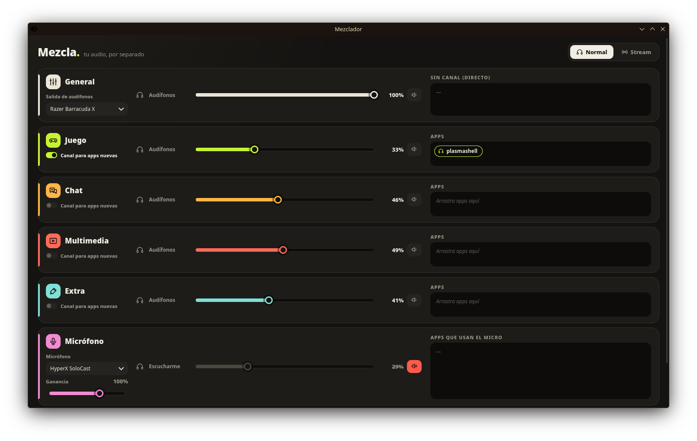

# Mezclador

Mezclador de audio para Linux (PipeWire) que separa el sonido del PC en canales:
General, Juego, Chat, Multimedia, Extra y Micrófono.



## Por qué existe

En Windows uso herramientas como SteelSeries Sonar para separar el audio del juego, del chat
y de la música, y mandar a mi stream una mezcla distinta de la que escucho yo. Al pasarme a
Linux (Bazzite) no encontré algo igual de sencillo, así que hice este mezclador inspirado en
esa idea: canales separados, cada app en su canal y una mezcla aparte para OBS.

- Volumen y silencio por canal, para tus audífonos y para el stream por separado.
- Arrastra cada aplicación al canal que quieras y se recuerda.
- Balance juego/chat y ganancia del micrófono.
- Modo stream: crea una mezcla aparte para OBS (`Monitor of Stream-Mix`).

## Requisitos

- PipeWire con `pactl` (pipewire-pulse)
- Python 3
- Flatpak (la ventana usa GTK4 + WebKit del runtime de GNOME)

## Instalación

```bash
./install.sh
```

Se instala para tu usuario en `~/.local/share/mezclador`, con un servicio de systemd
de usuario y un acceso en el menú de aplicaciones. Para quitarlo: `./uninstall.sh`.

## Aviso

Proyecto independiente y personal. No está afiliado, patrocinado ni respaldado por
SteelSeries; "SteelSeries" y "Sonar" son marcas de sus respectivos dueños y se mencionan
solo para explicar la inspiración. No usa código, diseño ni recursos de ese producto.
